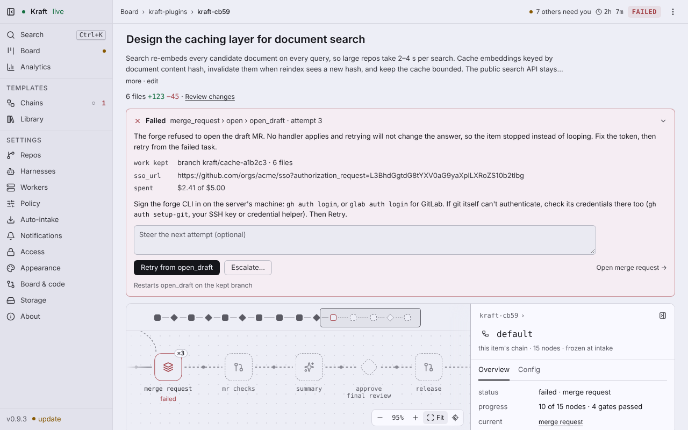
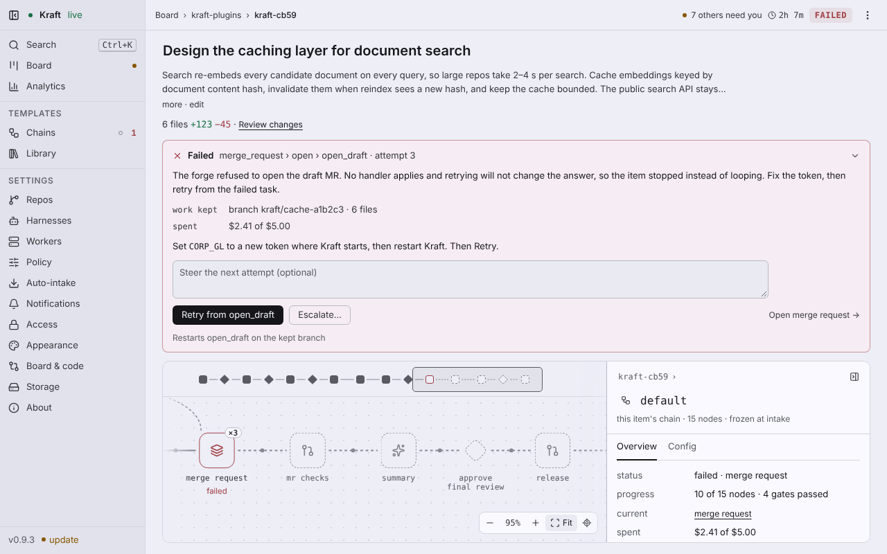
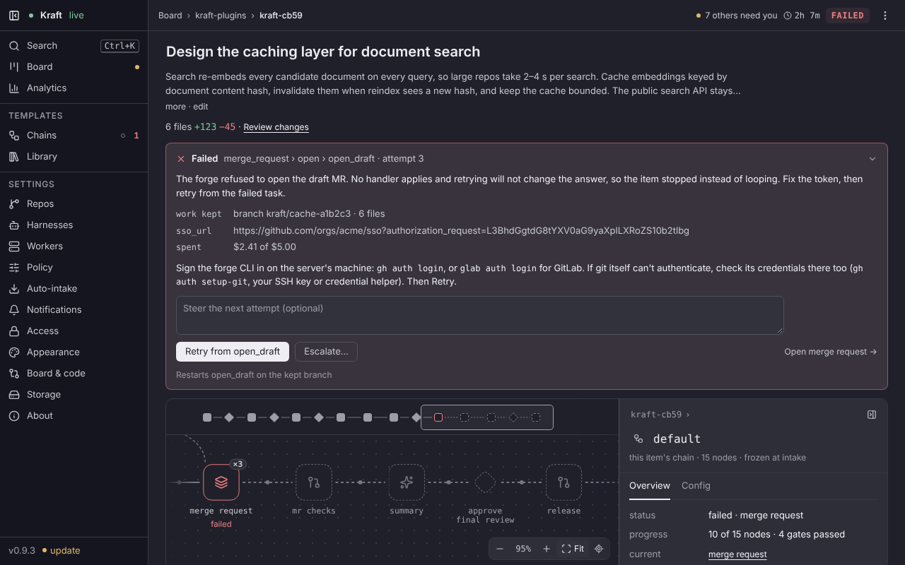
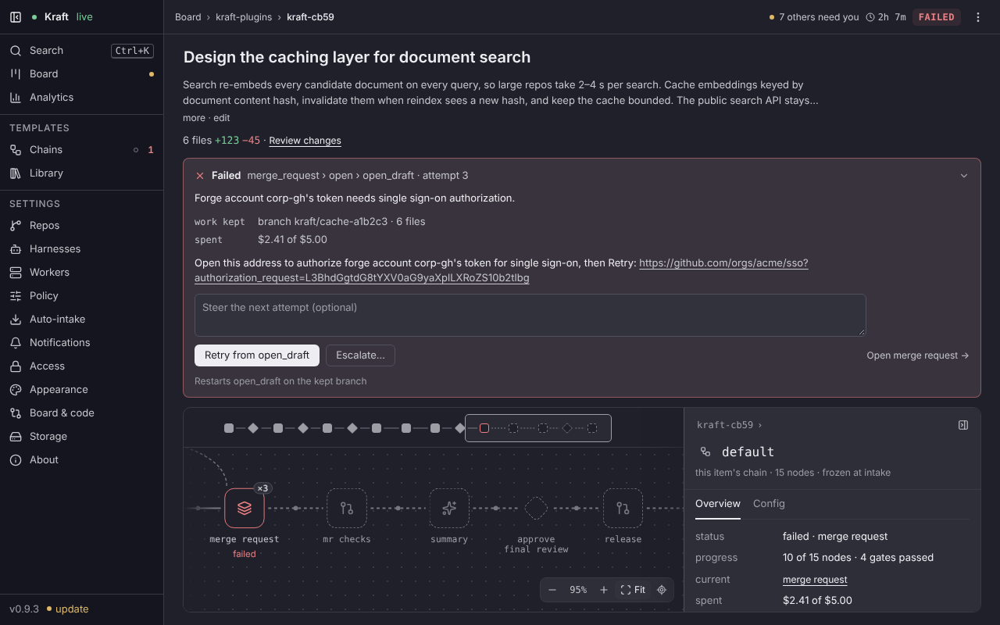
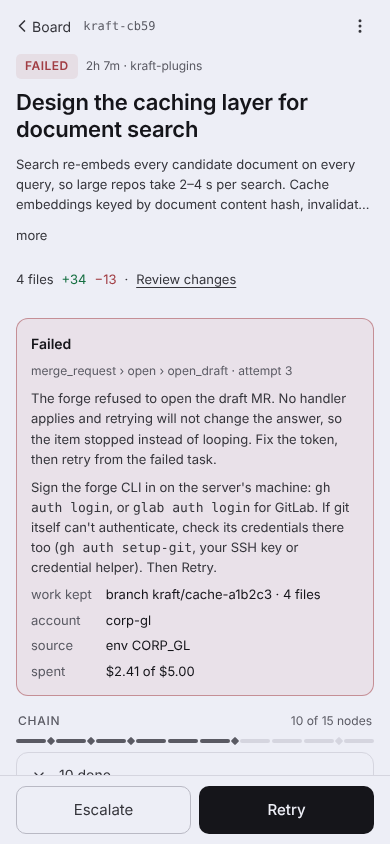
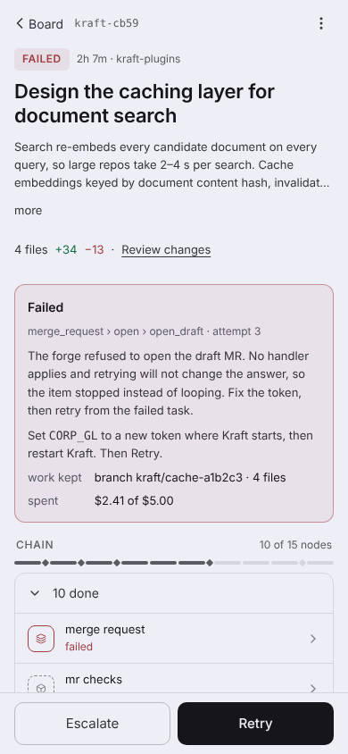
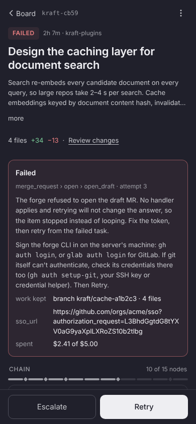
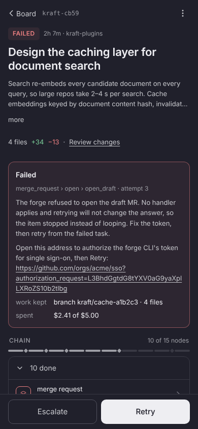

# Screenshots: PR #1221, the github-api backend

A failed item whose forge stop needs single sign-on for an API account (`facts.account: corp-gh`, `facts.sso_url`). Before is `main` (aba49fb0b), after is the branch (774db2edb). Mocked states from `frontend/e2e/contract/screens.ts`: `follow-ups/failed-forge-sso-account` (desktop, 1280 px) and `phone/item-failed-forge-sso-account` (phone, 390 px).

Before: the hint asks to authorize "the forge CLI's token". After: it names forge account `corp-gh`, kept on one line, with the address last.

| | Before | After |
|---|---|---|
| Desktop, light |  |  |
| Desktop, dark |  |  |
| Phone, light |  |  |
| Phone, dark |  |  |
