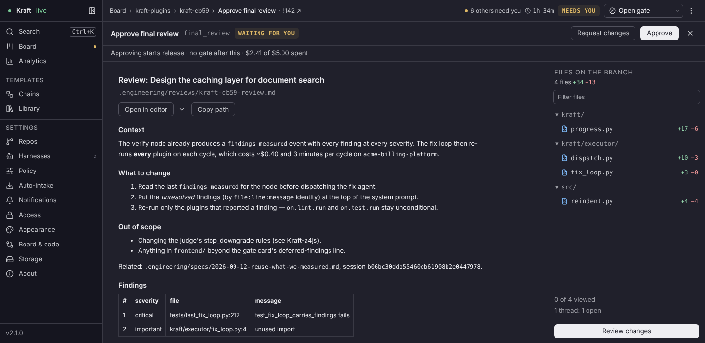

# Kraft

<!-- mcp-name: io.github.itsOmidKarami/kraft -->
<!-- The official MCP registry reads this line from the PyPI page to confirm the package is ours. -->

[](https://github.com/itsOmidKarami/kraft/actions/workflows/test.yml)
[](https://pypi.org/project/kraft-sdlc/)
[](https://github.com/itsOmidKarami/kraft/releases)
[](https://github.com/itsOmidKarami/kraft/blob/main/LICENSE)
[](https://kraft-sdlc.dev/)
[](https://kraft-sdlc.dev/demo/)

**A local orchestrator that takes your coding agent from spec to merge request,
stopping only when a decision is yours.**

**[Try the live demo](https://kraft-sdlc.dev/demo/)**: the web UI on sample
data, in your browser, with nothing to install.

Kraft isn't another coding agent. It runs the one you already use, and adds
what a single session can't: a process the agent can't skip, checks it doesn't
grade itself on, and a person at the decisions that matter.

Hand Kraft a task, start it and walk away. You file a task, a *work item*, from
the web UI, a phone or the CLI, and it waits paused until you start it. Your
agent then drafts a spec and a plan, stops for your approval of each, builds the
change on its own branch and opens a merge request. It's for developers tired of
babysitting a session; [when not to use Kraft](https://kraft-sdlc.dev/why#when-not-to-use-kraft)
says who it isn't for.

[](https://kraft-sdlc.dev/demo/)

## What you get

- **A process the agent can't skip.** Each work item follows a *chain*, a YAML
  file you can read and diff. Its *nodes* are steps such as write the spec,
  implement, verify and open the merge request. Some run your agent, some run a
  command and some stop for you.
- **Checks it doesn't grade itself on.** Kraft runs your tests in a node of its
  own, waits for your CI and has a separate reviewer decide whether a fix is
  done.
- **A person at the decisions.** A *gate* is a node where the chain stops for
  you. Read what the agent wrote, then approve it or request changes with a note
  that re-runs the node that wrote it. A gate stops the chain until a decision is recorded, and an agent's own calls to decide its gate are refused. Only a sandbox with a `network:` policy keeps an agent from deciding its own gates; no sandbox is set by default, and an unsandboxed agent runs as you. [Security](https://kraft-sdlc.dev/project/security-in-depth#agents-and-gates)
  has the scope.
- **Capped retries and spend.** Attempts, time and dollars are bounded. A capped
  item stops and hands you the full trace.
- **Your checkout stays as you left it.** Each item runs on its own branch in
  its own git worktree, so items run in parallel. Kraft is one local process,
  bound to loopback, and a tunnel reaches it from a phone.



## How the pieces fit

**Kraft** is the server, the `kraft` command and the web UI. The
**[Kraft plugin](https://kraft-sdlc.dev/guides/day-to-day/agent-integration)**
gives Claude Code, Codex, Cursor and Antigravity slash commands and Model
Context Protocol (MCP) tools to file work and clear gates from a session.
**[Kraft Lite](https://kraft-sdlc.dev/guides/kraft-lite)** runs a chain inside
one session, with no server. [Add-ons](https://kraft-sdlc.dev/guides/customize/share-chains-with-addons)
share chains, and the [VS Code extension](https://kraft-sdlc.dev/guides/day-to-day/vscode)
clears gates beside your code.

The extension runs in VS Code and editors built on it, such as Cursor and
VSCodium: install it from the
[VS Code Marketplace](https://marketplace.visualstudio.com/items?itemName=kraft-sdlc.kraft)
or [Open VSX](https://open-vsx.org/extension/kraft-sdlc/kraft).

## Requirements

- **macOS or Linux.** Windows isn't supported, and WSL is untested.
- **`git`**, with `user.name` and `user.email` set. Kraft commits the agents'
  work under that identity.
- **[uv](https://docs.astral.sh/uv/)**, which fetches a Python 3.12 or newer if
  you have none. Or Homebrew on macOS.
- **[Claude Code](https://code.claude.com/docs)**, installed and signed in. The
  shipped chains run every agent task on it. Codex, Cursor, Gemini CLI,
  Antigravity, OpenCode and Amp work as
  [harnesses](https://kraft-sdlc.dev/reference/harnesses) after a chain edit.
- **`gh` or `glab`**, signed in, for the nodes that open and merge the merge
  request on GitHub or GitLab.

Kraft is free and Apache-2.0 licensed. Your agent provider bills the sessions
Kraft runs, and the shipped policy caps spend per work item and per day: see
[Caps and budgets](https://kraft-sdlc.dev/concepts/caps-and-budgets).

## Install and run

```bash
uv tool install kraft-sdlc
```

On macOS, Homebrew works too:

```bash
brew tap itsOmidKarami/kraft && brew install kraft
```

To drive Kraft from Claude Code, add the plugin:

```bash
claude plugin marketplace add itsOmidKarami/kraft
claude plugin install kraft@kraft
```

Start the server in its own terminal and leave it running. It listens on
`http://127.0.0.1:8765`:

```bash
kraft
```

In a second terminal, connect the repo you want Kraft to work on. It proposes
the repo's test and setup commands and asks you to accept them:

```bash
cd ~/code/my-project
kraft repo connect
```

Open `http://127.0.0.1:8765`, then follow
[Your first work item](https://kraft-sdlc.dev/get-started/first-work-item): it
files a small change, stops at a gate for your approval and finishes. The
[install guide](https://kraft-sdlc.dev/get-started/install) has the other agents,
updating and uninstalling. Coming from 1.4? Read
[Upgrade from 1.4](https://kraft-sdlc.dev/guides/run/upgrade-from-1-4) first.

## Where to go next

- [Why Kraft](https://kraft-sdlc.dev/why): what it does that a session, a loop or a skill doesn't.
- [Concepts](https://kraft-sdlc.dev/concepts/vocabulary): work items, chains, nodes, gates, caps.
- [CLI reference](https://kraft-sdlc.dev/reference/cli): every `kraft` verb.
- [Security](https://kraft-sdlc.dev/project/security): the threat model; report vulnerabilities as [SECURITY.md](https://github.com/itsOmidKarami/kraft/blob/main/SECURITY.md) describes.
- [Discussions](https://github.com/itsOmidKarami/kraft/discussions): questions and ideas.

The [releases](https://github.com/itsOmidKarami/kraft/releases) page says what
each version adds. Kraft is young: expect rough edges and frequent releases, and
report bugs in [GitHub issues](https://github.com/itsOmidKarami/kraft/issues).

*Kraft* is German for force; in English, its cousin *craft* means skill. Your
agent brings the craft; Kraft is the force that carries it from spec to merge
request.

## Contributing

Set-up, the `just` recipes, tests and the contribution rules are in
[CONTRIBUTING.md](https://github.com/itsOmidKarami/kraft/blob/main/CONTRIBUTING.md). Releases are described in
[RELEASING.md](https://github.com/itsOmidKarami/kraft/blob/main/RELEASING.md). Everyone taking part follows the
[Code of Conduct](https://github.com/itsOmidKarami/kraft/blob/main/CODE_OF_CONDUCT.md).
