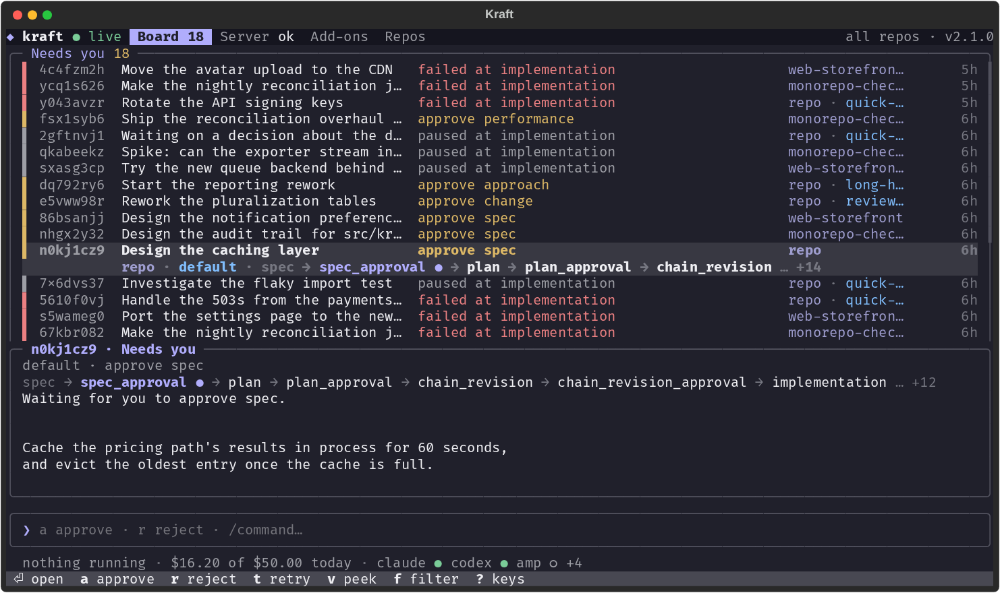

# Releasing

How a maintainer cuts a Kraft release. Pull request authors need only
[CONTRIBUTING.md](CONTRIBUTING.md#pull-requests-and-release-labels): the label
and the `## Changelog` section. Never edit `CHANGELOG.md` by hand: the release
writes it, and each pull request's `## Changelog` section is its release note.

Kraft's version is the git tag. `setuptools-scm` derives it at build time, so
there is no `version =` line to bump.

The job runs in the `release` GitHub environment, whose deployment branches are
limited to `main`; the PyPI trusted publisher names that environment. Both are
settings outside the repo: recreate them if the repository is ever moved.

## Cut a release

Actions → **release** → **Run workflow** on `main`. Tick **dry run** first to see
the version and notes on the run's summary page, and in the job log, without
releasing anything.
Leave **sha** empty to release main's tip, or give a commit on main to release
an earlier point. That is useful while the tip's tests are still running. It
can't be a commit behind the newest release.

`.github/workflows/release.yml` collects every pull request merged since the
previous `vX.Y.Z` tag and bumps by the largest label among them: two
`release::minor` and three `release::patch` is a minor release. If all of them
are `release::none`, there is no version to bump and it releases nothing. The
notes are those pull requests' `## Changelog` sections, grouped into breaking
changes, new features and fixes.

It refuses to run until `test` has passed on the commit being released. Then it
builds the wheel, smoke-tests it, pushes the tag, creates the GitHub Release
with the wheel attached, and publishes to PyPI. The smoke test installs the
wheel on the floor Python, 3.12, since the one wheel serves every supported
version.

The tag is created locally before the build, because setuptools-scm reads the
version from it. It is pushed only after the smoke test passes, so a failed
build leaves nothing behind.

A stable release also dispatches the `docs` workflow, so the docs site's default
version switches to the new tag. If the run shows a "docs rebuild not
dispatched" warning, run **docs** by hand from the Actions tab on `main`.

### Highlights

Put `notes::highlight` on the release's headline change, next to its
`release::` label, and on no more than one or two pull requests per release. A
minor or patch pull request's entry moves into a **Highlights** section at the
top of the notes. A major one is listed under Highlights and still under
Breaking changes, so a breaking release always says what breaks. Its
`release::` label still counts toward the bump.

Write its `## Changelog` section as a headline, since it now opens the release
notes. You can add the label after merge, then dry-run again to check.

Give a highlight a picture when the change is something to see: one screenshot
or GIF on its own line, indented under the bullet after a blank line, so the
number stays on the bullet's words and the picture stays in its entry. Link it
by its full URL, since the notes are read on GitHub, in `CHANGELOG.md` and on the
Marketplace:

```markdown
- `kraft console`: a terminal UI for Kraft.

  
```

Use a picture the docs already show (`.github/assets/`, taken by
`just docs-screenshots`), or add one there in the same pull request, and link it
on `main`. The release points an image linked from `main` at its own tag
(`dev/release_artifacts.py pin-notes`), in the GitHub Release and both
changelogs, so the notes keep this release's picture after `main`'s is retaken.

An image or video dropped into the description on GitHub works too. Its
`user-attachments` URL never changes, so nothing is pinned. A dropped image may
sit right under the bullet as the editor writes it. A dropped video needs the
blank line, since GitHub plays one only when it stands alone in its paragraph.

Keep pictures to highlights: an entry under New or Fixes is one line.

The release stops and names the pull request in three cases:

- It has `notes::highlight` and `release::none`. There is no entry to highlight,
  so remove one of the two labels.
- It has `notes::highlight` and no `release::` label. Add one that ships, not
  `release::none`.
- It has a near miss such as `Notes::Highlight`. Fix the label; `notes::highlight`
  is the only `notes::` label.

### Check that your label worked

Run the release workflow as a dry run. On the run's summary page, confirm that
the version bump matches the largest label among the merged pull requests and
that your pull request's `## Changelog` line appears under the right heading. A
highlighted pull request's line is under Highlights, and a major one is under
Breaking changes as well.

If your pull request is missing or listed by its title, fix the label or the
section in the description and run the dry run again.

A pull request merged without a label stops the next release, naming it. Label
it (labels can change after merge) and run the release again.

## Before a stable run

A dry run can't tell you whether a credential still works, and only a stable run
publishes the extension. Both registries take no token, so nothing expires, but
the trust behind them can be removed. Check before you press the button:

- [ ] **The Marketplace identity can still publish.** The workflow signs in over
  OIDC as the Azure managed identity `kraft-release-publisher`. At
  <https://marketplace.visualstudio.com/manage/publishers/kraft-sdlc>, signed in
  as the publisher's owner, check **Members** lists it as a *Contributor*. In
  the Azure portal, check the identity's **Federated credentials** still hold
  `github-kraft-release`, for this repository's `release` environment.
- [ ] **Open VSX still trusts this workflow.** At
  <https://open-vsx.org/user-settings/trusted-publishers>, signed in as an owner
  of the `kraft-sdlc` namespace, check it lists this repository, `release.yml`
  and the `release` environment.

## What a stable run publishes

In this order. Unless noted below, a step that fails stops the ones after it,
and what already published stays published: the tag exists, so a re-run finds
nothing new to release and you finish the rest by hand. Secrets are repository
secrets or secrets of the `release` environment.

1. **GitHub Release** `vX.Y.Z`, with the wheel and `kraft-X.Y.Z.vsix` attached.
   Needs only `GITHUB_TOKEN`. Check:
   `gh release view vX.Y.Z --json assets --jq '.assets[].name'` lists both files.
2. **Docs rebuild**, a dispatch of the `docs` workflow so `/` serves the
   new tag. Needs `GITHUB_TOKEN` with `actions: write`, and only warns when it
   can't dispatch. Check: `gh run list --workflow docs --limit 1` shows
   success.
3. **PyPI**, [`kraft-sdlc`](https://pypi.org/project/kraft-sdlc/). Needs no
   secret: trusted publishing, with the publisher registered on PyPI for this
   repository, `release.yml` and the `release` environment. Check:
   `curl -sf -o /dev/null https://pypi.org/pypi/kraft-sdlc/X.Y.Z/json && echo ok`.
   The run does this itself and fails after 10 minutes.
4. **The stamp pull request**, which brings the five manifests and both
   changelogs up to date on `main`. Needs the release-bot GitHub App:
   `RELEASE_BOT_CLIENT_ID` and `RELEASE_BOT_PRIVATE_KEY`, with the App
   installed on `kraft` and allowed contents and pull-request writes. Auto-merge
   must be on for the repository. Check:
   `gh pr list --state merged --search "stamp plugin manifests" --limit 1` names
   `vX.Y.Z`.
5. **The Homebrew tap**, `itsOmidKarami/homebrew-kraft`, whose formula is pointed
   at step 1's wheel. Needs `HOMEBREW_TAP_TOKEN`: contents write on the tap,
   and the right to push to its protected `main`. Check:
   `curl -s https://raw.githubusercontent.com/itsOmidKarami/homebrew-kraft/main/Formula/kraft.rb | grep '^  url'`
   names `vX.Y.Z`.
6. **VS Code Marketplace**, `kraft-sdlc.kraft`. Needs no secret: the job signs
   in to Azure over OIDC from the `release` environment and publishes as the
   managed identity `kraft-release-publisher`, a Contributor on the
   `kraft-sdlc` publisher. **If the identity, its membership or its federated
   credential is gone the publish fails and the run goes red.** The `.vsix` is
   still on the GitHub Release. Check:
   `npx --prefix vscode vsce show kraft-sdlc.kraft`, and read the version.
7. **Open VSX**, `kraft-sdlc/kraft`, which VSCodium and Cursor install from.
   Needs no secret: trusted publishing, registered for `kraft-sdlc.kraft`
   against this workflow and the `release` environment. Check:
   `curl -s https://open-vsx.org/api/kraft-sdlc/kraft | jq -r .version`.

The VS Code extension goes last, after the run has checked that PyPI serves the
new version. Its Marketplace login is the likeliest thing to lapse. Run last, a
failure there skips only the extension's own steps, never Homebrew or the stamp
pull request, and the run still goes red. Open VSX needs no Azure login, so it
still publishes when only the Marketplace step failed.

Last is also the safe order for users. VS Code updates the extension on its own,
and an extension newer than the Kraft it talks to is read-only.

### Recover a missed extension publish

Any failure before the extension leaves it unpublished. That covers minting the
stamp token, the stamp pull request, Homebrew and the PyPI check, which fails
when PyPI hasn't served the version within 10 minutes, even if it does a minute
later. A re-run can't recover it, because the tag exists and the run plans
nothing. Fix the step that failed, then publish the extension by hand from the
GitHub Release:

```bash
gh release download vX.Y.Z -p '*.vsix'
npx --prefix vscode ovsx publish kraft-X.Y.Z.vsix -p <token>
```

The Marketplace by hand has no token to use: upload the `.vsix` at
<https://marketplace.visualstudio.com/manage/publishers/kraft-sdlc>, in the
extension's **⋮ → Update** menu, signed in as the publisher's owner.

The Open VSX publish by hand can't use trusted publishing, which works only
inside the workflow. It needs an access token from
<https://open-vsx.org/user-settings/tokens>, made by an owner of the
`kraft-sdlc` namespace.

### What the build writes into the artifacts

- **The README's images are pinned to the tag.** `README.md` links its
  screenshots on `main`, which PyPI would show on every version's page for good.
  After the build, `dev/release_artifacts.py pin-wheel` rewrites the wheel's
  description to point at the tag, and the smoke test fails a wheel that still
  links `main`. It edits the wheel, not `README.md`, because a modified tree
  makes setuptools-scm version the build as a dev release.
  - The `.vsix` does the same through `vsce package --baseImagesUrl`, so
    `vscode/README.md` links its images relative to `vscode/`.
  - On a stable tag, `pin-wheel` also points links to `main`'s docs
    (`/kraft/next/…`) at the release's own (`/kraft/…`).
- **`vscode/CHANGELOG.md` is written by the release, never by hand.** Each
  section is Kraft's notes for that version, from the same pull requests as
  `CHANGELOG.md`. The build adds the new section for the package and puts the
  file back; the stamp pull request commits it to `main` with the root one.

A run with **sha** set to a commit from before `vscode/CHANGELOG.md` existed
fails at the extension build, before the tag is pushed, so a re-run at a later
commit is safe.

## Plugin manifest versions

Each plugin carries its own `version` in `.claude-plugin/plugin.json` and
`.cursor-plugin/plugin.json`, for `plugins/kraft` and `plugins/kraft-lite`, and
Kraft Lite also in `gemini-extension.json`. You never edit these by hand, and
pull requests never touch them.

Right after it tags a release, `release.yml` stamps those five files, the
extension's `vscode/package.json` and its lockfile with
`dev/stamp_plugin_versions.py`. It writes the release notes into `CHANGELOG.md`
and `vscode/CHANGELOG.md`, then opens and auto-merges a `release::none` pull
request with all of them. Stamping on a release spares every open pull request
from predicting its own version.

That pull request needs its own credential. The default `GITHUB_TOKEN` can't
open it, because GitHub suppresses workflow runs triggered by that token, which
would leave the required checks pending forever. `release.yml` mints a
short-lived token from a GitHub App instead (`RELEASE_BOT_CLIENT_ID` and
`RELEASE_BOT_PRIVATE_KEY`), scoped to contents and pull-request writes.

The tagged commit therefore lags its release by design: the manifests and
changelogs at `vX.Y.Z` still describe the release before. The artifacts don't
lag: the wheel's version comes from the tag, and the `.vsix` takes its version
from the `vsce package` command line and its changelog from the build.

## Docs "What's new" page

After a minor or major release, add its section to
[What's new](docsite/content/6.project/3.whats-new.md): its highlights (one with
sub-bullets counts as one) and at most two more of its most notable changes,
a bullet each with a link to the
page that describes it, in a `release::none` pull request. Nothing writes it
for you, and a patch release adds nothing.

## Docs "Added in" notes

A docs page, section or CLI verb that is new since the last release carries
`_Added in next_`, written by its author (see
[docs/writing-docs.md](docs/writing-docs.md#page-rules)). Nobody writes a
version number, because the release does, in the stamp pull request, with
`dev/stamp_docs_added_in.py VERSION`:

- **X.Y.0 (Y above 0):** every `next` becomes `X.Y`, so the site's chip reads
  "Added in 2.1" instead of "Unreleased".
- **X.0.0:** every note is removed, numbered ones too. A new major starts clean,
  and the site's version menu already says which major you are reading.
- **X.Y.Z (Z above 0):** a patch adds no features, so a `next` note means a
  feature shipped under a patch label. The script writes nothing and exits 1,
  the stamp step warns and adds a line to the stamp pull request, and the
  manifests and changelogs are still stamped. `dev/check_docs_added_in.py` warns
  on `main` until someone removes the notes by hand or relabels and re-cuts the
  release as a minor; the next minor stamps them with its own number.

Every release also deletes the `<!-- renamed from: ... -->` and
`<!-- not new: ... -->` comments, which only excuse a heading from a note until
the next release is the comparison point.

The tag is cut before the stamp pull request merges, so the tag's own pages still
say `next`. `dev/build_docs_site.sh` stamps its copy of the tag's content the same
way, so the release docs at `/` show the number once built. Until the stamp pull
request merges, the check warns on `main` without failing `lint`.

## Verify a release

Run the workflow with **dry run** ticked first: the summary page must show the
version and notes you expect. After a real run, confirm that the tag and GitHub
Release exist with the wheel attached, the version is on
[PyPI](https://pypi.org/project/kraft-sdlc/) and the stamp pull request has
merged. The checks under
[What a stable run publishes](#what-a-stable-run-publishes) cover the other
targets.

A dry run stops after the notes, so it can't tell you the wheel was pinned, the
`.vsix` got its version or a credential works. A change to any of those first
shows on a real pre-release (`rc`, which reaches PyPI and the GitHub Release and
nothing else).

A stable run checks its own publishing. It fails if PyPI doesn't serve the new
version within 10 minutes, and warns if the Marketplace hasn't listed the
extension within 5; check that by hand, since the Marketplace can be slow to
index. It dispatches the docs rebuild without waiting, so confirm the **docs**
run passed.

If the run stops on an unlabelled pull request, label it and run the workflow
again. A failed build leaves no tag behind, so re-running is safe.

## Cut a pre-release

Same button, with **pre** set to `alpha`, `beta` or `rc`. It cuts the version
the labels plan as `vX.Y.ZaN`, `bN` or `rcN`, numbered past the ones that
exist. It is a GitHub pre-release: only `rc` also goes to PyPI, and none of
them touch homebrew, the stamp PR, the Marketplace or Open VSX. Users pick one
up with `kraft admin update --channel rc|beta|alpha`. The next stable release's
notes still cover everything since the last stable tag.

The GitHub Release's notes open with how to install it. A stable release's notes
and the changelogs leave that line out. It gives three steps:

1. Install the wheel with
   `uv tool install --force --python 3.13 "kraft-sdlc[vector]==X.Y.ZrcN"`. For a
   beta or alpha, use `"kraft-sdlc[vector] @ <the wheel attached to its release>"`.
   This keeps the extra and the Python from any install.
2. Update with `kraft admin update --channel` for its kind.
3. For VS Code, install the `kraft-<version>.vsix` attached to the release. The
   Marketplace extension stays at the last release, and it is read-only against
   a new major's pre-releases.

A pre-release's `.vsix` is stamped `X.Y.Z-rc.N` (`-alpha.N`, `-beta.N`): semver,
so VS Code orders it after the last release and before `X.Y.Z`. Someone who
side-loads an rc is therefore offered the real `X.Y.Z` when it ships. The count
is its own number (`rc.10`, not `rc10`) because semver compares text, and `rc10`
would sort below `rc9`.
