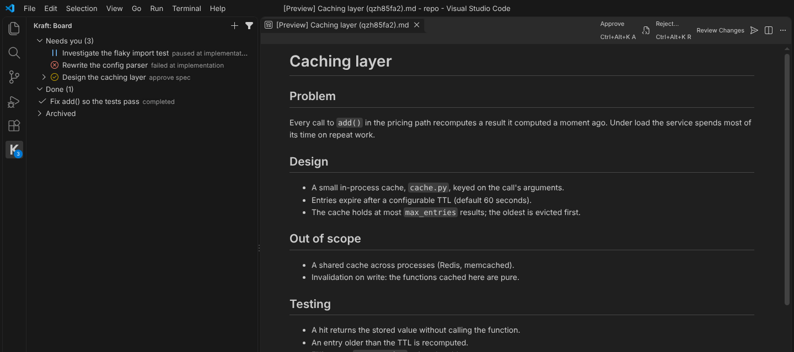
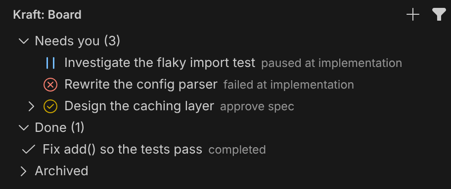
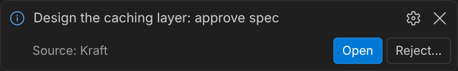
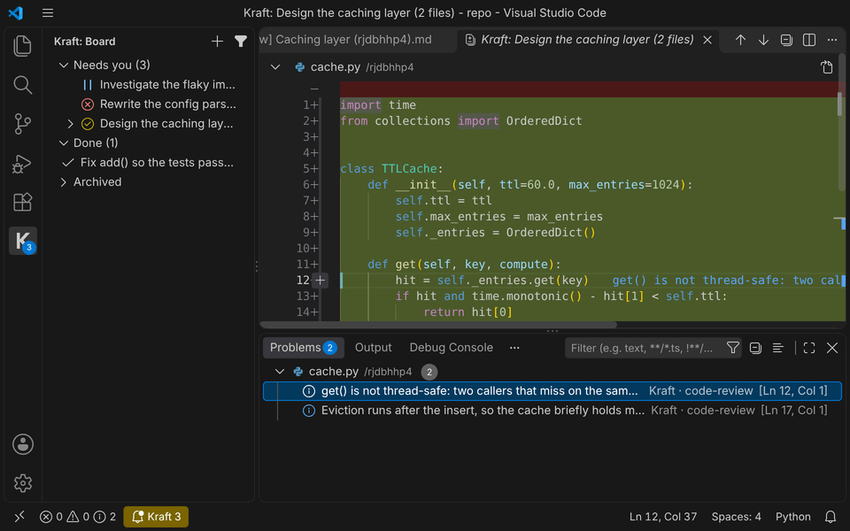
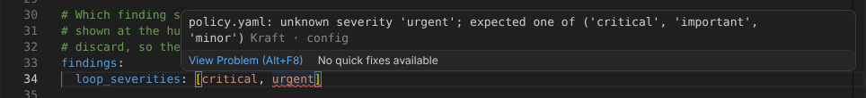

# Kraft for VS Code

**A local orchestrator that takes your coding agent from spec to merge request,
stopping only when a decision is yours.**

Kraft isn't another coding agent. It runs the one you already use (Claude Code,
Codex and others), and adds what a single session can't: a process the agent
can't skip, checks it doesn't grade itself on, and a person at the decisions
that matter.

This extension brings those decisions into the editor. See what every work item
is doing, approve or reject a gate, review a branch's diff with the review
agents' findings on the lines they name, and edit Kraft's config with errors
flagged as you type.



## Get started

1. Install Kraft:

   ```bash
   uv tool install kraft-sdlc
   ```

   or with Homebrew: `brew tap itsOmidKarami/kraft && brew install kraft`.
   The [Install page](https://kraft-sdlc.dev/get-started/install)
   covers the other ways.
2. Start it: run `kraft`.
3. Open VS Code. The extension finds the running Kraft on its own: it reads
   `KRAFT_HOST` and `KRAFT_PORT`, then `bind` and `port` from
   `$KRAFT_HOME/config/access.yaml`, and falls back to `127.0.0.1:8765`. Set
   `kraft.url` only when Kraft listens somewhere else.

If Kraft isn't running, the board shows `Kraft isn't running — Start`, which
starts Kraft in the background with `kraft admin start --detach`.

## Board



The Kraft view in the activity bar lists every work item, grouped as in the web UI, with a badge counting the ones waiting on you. Each row shows the item's title, then why it is there ("approve spec", "agent asks: …", "failed at implementation"). Right-click an item to pause, resume, retry, skip, escalate, cancel or archive it, or to open its worktree, merge request, spec and plan, worker log or the web UI.

## Gates



When a gate opens, a notification offers **Open** and **Reject…**. Open shows the gate's document as a rendered Markdown preview, with Approve and Reject in its tab's title bar: you approve a document once you have read it. A reject asks for a reason, which goes to the agent. **Kraft: Next Gate** in the Command Palette opens the longest-waiting gate, so a queue of gates goes by from the keyboard (`Ctrl+Alt+K N`, or `Cmd+Alt+K N` on macOS).

## Review



Run **Review Changes** from an item's menu to open its branch in the multi-file diff editor. The review agents' findings show on the lines they name and in the Problems panel. Comment on any line, then run **Submit Review** to request changes, comment or approve. Your comments are Kraft's review threads, the same ones the web UI shows.

## Config



Kraft's config files under `$KRAFT_HOME/config` (`policy.yaml`, `chains/*.yaml` and the rest) are checked by the running Kraft as you edit, with the line at fault flagged. With [Red Hat YAML](https://marketplace.visualstudio.com/items?itemName=redhat.vscode-yaml) installed they also get completion from Kraft's JSON Schemas. The gear on the board's title bar, **Open Config…**, lists the files and opens the one you pick.

## Requirements

Kraft running on this machine or on one you sign in to, on the extension's major release and at least its minor, and a trusted workspace to act. Otherwise the extension is read-only: see [the version rule and Restricted Mode](https://kraft-sdlc.dev/reference/vscode-extension#if-the-extension-is-read-only).

## Settings

`kraft.url`, `kraft.path` and `kraft.notifications`: see [the settings table](https://kraft-sdlc.dev/reference/vscode-extension#settings).

## Learn more

- [Kraft for VS Code](https://kraft-sdlc.dev/guides/day-to-day/vscode): the guide, from install to a cleared gate
- [Reference](https://kraft-sdlc.dev/reference/vscode-extension): keys, settings, row buttons, search and the status bar
- [Why Kraft](https://kraft-sdlc.dev/get-started/why-kraft): what it does that a session, a loop or a skill doesn't
- [GitHub](https://github.com/itsOmidKarami/kraft): source, releases and issues
