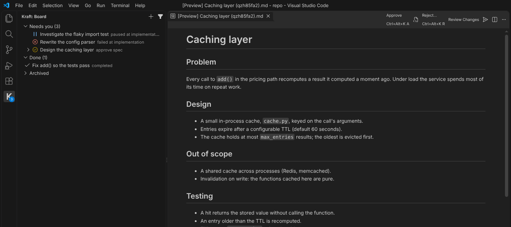
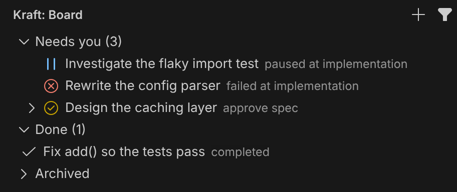
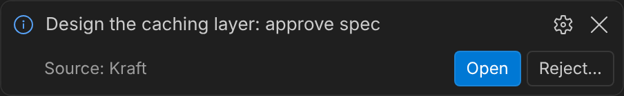
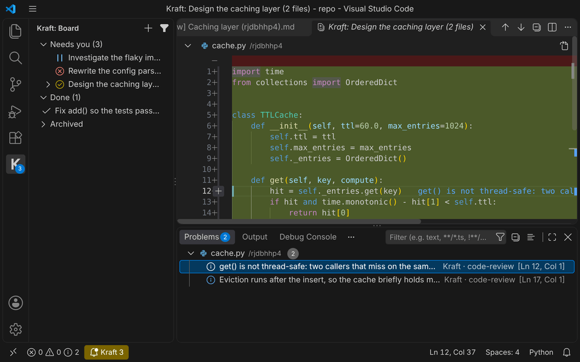
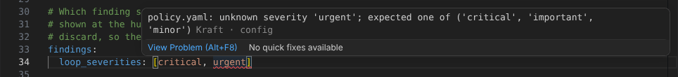

# Kraft for VS Code

**A local orchestrator that takes your coding agent from spec to pull request,
stopping only when a decision is yours.**

Kraft isn't another coding agent. It runs the one you already use (Claude Code,
Codex and others), and adds what a single session can't: a process the agent
can't skip, checks it doesn't grade itself on, and a person at the decisions
that matter.

This extension brings those decisions into the editor. See what every work item
is doing, approve or reject a gate, review a branch's diff with the review
agents' findings on the lines they name, and edit Kraft's config with errors
flagged as you type.



## Get started

1. Install Kraft:

   ```bash
   uv tool install kraft-sdlc
   ```

   or with Homebrew: `brew tap itsOmidKarami/kraft && brew install kraft`.
   The [Install page](https://kraft-sdlc.dev/get-started/install)
   covers the other ways.
2. Start it: run `kraft`.
3. Open VS Code. The extension finds the running Kraft on its own: it reads
   `KRAFT_HOST` and `KRAFT_PORT`, then `bind` and `port` from
   `$KRAFT_HOME/config/access.yaml`, and falls back to `127.0.0.1:8765`. Set
   `kraft.url` only when Kraft listens somewhere else.

If Kraft isn't running, the board shows **Kraft isn't running — Start**, which
runs `kraft admin start` in a terminal.

## Board



The Kraft view in the activity bar lists every work item, grouped as in the web
UI, with a badge counting the ones waiting on you. Each row shows the item's
title, then why it is there ("approve spec", "agent asks: …", "failed at
implementation"), with an icon whose colour tells a gate from a failure. It
shows the repos open in the window; the filter button shows every repo.
Right-click an item to pause, resume, retry, skip, escalate, cancel or archive
it, or open the **Open** submenu for its worktree, its merge request, its spec
and plan, the worker log or the web UI. Hover a row for its id and the full
reason.

The status bar item `Kraft` shows a bell and the count on a warning background
while anything waits on you, and a check mark when nothing does. Click it for
the log, the web UI and Retry Now.

## Gates



When a gate opens, a notification offers **Open** and **Reject…**; read-only, it
offers Open only. Open shows the gate's document as a rendered Markdown
preview, with Approve and Reject in its tab's title bar: you approve a document
once you have read it. Approving says what was approved ("Approved: title ·
approve spec"), and asks first when the gate merges or pushes, from Approve
or from Submit Review. Several notifications at once become one ("3 items need
you") with a Next Gate button. A reject asks for
a reason, which goes to the agent.

**Kraft: Next Gate** in the Command Palette opens the gate document directly when
one gate waits, and with several lists them, longest-waiting first, so a queue of
gates goes by without the mouse.

Default keys (`Cmd+Alt+K` on macOS), each chord starting `Ctrl+Alt+K`:

| Key | Does |
|---|---|
| `Ctrl+Alt+K N` | Next Gate |
| `Ctrl+Alt+K A` | Approve, on a gate document |
| `Ctrl+Alt+K R` | Reject…, on a gate document |
| `Ctrl+Alt+K S` | Submit Review |

## Review



Run **Review Changes** from an item's menu on the board, or from a gate
document's title bar, to open its branch in the multi-file diff editor. Findings from the review agents show on the lines they
name, as a colored bar with the message beside the line, and in the Problems panel.

Comments are Kraft's review threads, the same ones the web UI's review and
`kraft view threads` show, with their label, lines and side. Every comment is a
draft until you submit a review, wherever it was written. Edit or delete your
drafts, and resolve or reopen a submitted thread, from its title bar. A draft
must-fix thread blocks Approve.

**Submit Review** asks for the outcome and an optional note. At a gate it offers
Request changes, Comment or Approve; with no gate, Request changes only, which
a paused item queues until you resume it. Request changes asks where the work
restarts. Approve with a must-fix thread open lists the threads that block it.
Approving with drafts asks to send them with the approval. **Discard Review
Comments** deletes every draft on the item, the web UI's and the CLI's
included. Both show on an item with draft comments that is at a gate or stopped
on you (paused, failed or out of budget), and on any other item once its review
is open.

## Config



The gear on the board's title bar, **Open Config…**, lists Kraft's config files
and chains with a line on what each holds, and opens the one you pick. It also
offers `sandbox.yaml` and `detectors.yaml` before they exist: saving creates them.

Kraft's config files under `$KRAFT_HOME/config` (`policy.yaml`,
`harnesses.yaml`, `chains/*.yaml` and the rest) are checked by the running
Kraft as you edit, with the line at fault flagged. With
[Red Hat YAML](https://marketplace.visualstudio.com/items?itemName=redhat.vscode-yaml)
installed they also get completion from Kraft's JSON Schemas. On a chain file,
**Show Resolved Chain** previews the chain after inheritance. On save, the
extension offers to reload Kraft, or to restart it for files Kraft reads only at
startup.

## Requirements

- Kraft running on the same machine (`kraft`, or `kraft admin start`), on the
  extension's major release and at least its minor: the 2.0 extension needs
  Kraft 2.0 or a later 2.x. Against any other Kraft the extension turns
  read-only: the board still updates, every action is disabled, and the status
  bar's tooltip says whether to update Kraft or the extension.
- A trusted workspace to act. In Restricted Mode the board, gate documents and
  diffs are read-only, and config checks wait until you trust the workspace.
- [Red Hat YAML](https://marketplace.visualstudio.com/items?itemName=redhat.vscode-yaml)
  for completion in config files. The extension offers it once if it is missing.

## Settings

- `kraft.url`: where Kraft listens. Empty reads `KRAFT_HOST` and `KRAFT_PORT`,
  then `bind` and `port` from `$KRAFT_HOME/config/access.yaml`. Set it in your
  user or Remote settings only: a workspace's settings cannot change it.
- `kraft.path`: the `kraft` binary **Start Kraft** runs, and the restart a
  config change offers. Empty runs `kraft` on your `PATH`; a leading `~` means
  your home folder. Set it in your user or Remote settings only.
- `kraft.notifications`: `all`, `gates` or `off`, which states raise a
  notification. `gates` announces only gates; `all` also announces an item that
  stopped and needs you.

## Learn more

- [Kraft for VS Code](https://kraft-sdlc.dev/guides/vscode), the guide to this extension
- [Why Kraft](https://kraft-sdlc.dev/get-started/why-kraft): what it does that a session, a loop or a skill does not
- [Documentation](https://kraft-sdlc.dev/)
- [GitHub](https://github.com/itsOmidKarami/kraft): source, releases and issues
